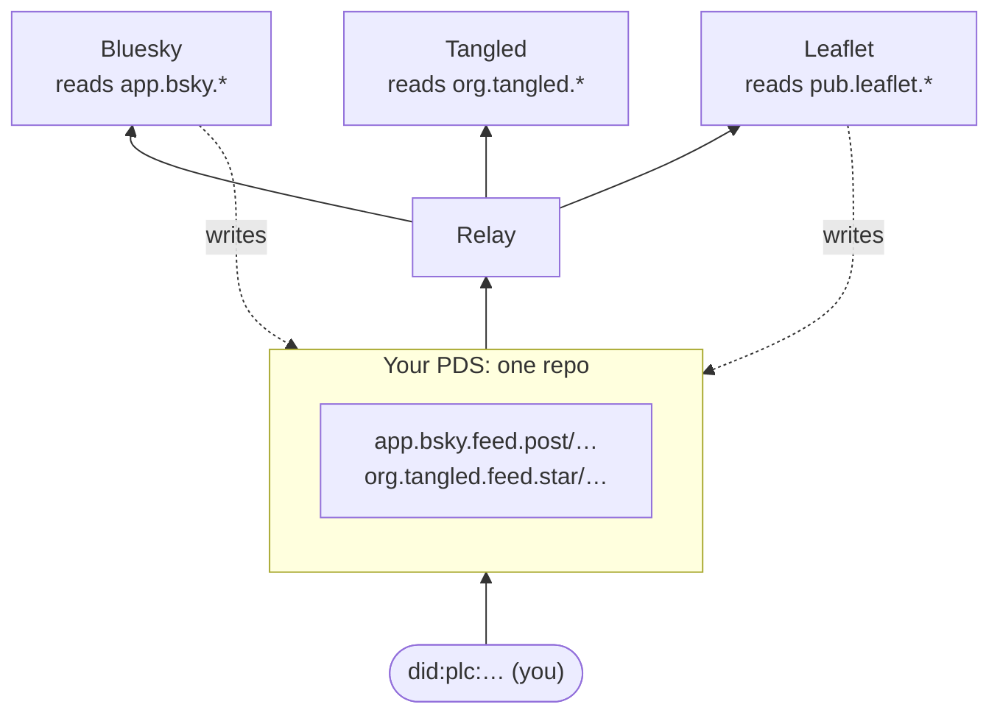

I recently learned about a decentralized git forge called
[Tangled](https://tangled.org) which made me curious to learn more about
federation. I am vaguely familiar with the idea, but I don't know how it
actually works, so I looked it up and got to reading.

Apparently, Tangled is built on top of the Authenticated Transfer Protocol (AT
Proto). It took me a few tries to get a passable understanding of how that
works, so here's what I learned:

* **AT Proto** splits the jobs of a normal application into separate services
* **Decentralized ID** (DID) is your permanent ID
* **Handle** points to your DID
* **Public Ledger of Credentials** (PLC) records your DID for others to find
* **Personal Data Server** (PDS) stores your personal data
* **Relays** monitor every PDS for changes and broadcasts the events
* **AppViews** subscribe to relays and keep an index of the data needed for the application

*(Side note: an extra reason I wrote all of these down is because there are so
many acronyms I couldn't keep straight, and many resources just expect you to
already know what they mean* 🙄*)*



These are the main pieces to AT Proto, which gives you control over your data.
That's great! Any time I change something (like my profile picture) on Tangled,
it updates my PDS, then gets notified of the change via the relay.


## Controlling my data

This is the first federated service I signed up for, so Tangled created a DID
for me, created a handle `miccah.tngl.sh`, and hosts my PDS. That's cool and
super useful, but I wanted to feel more in control of my identity. My goal
is to change my handle to `miccah.io` and add my own private key to be able
to control changes to my DID document.


### Updating my handle

1. Add a DNS TXT record to my domain
   ```
   _atproto.miccah.io	"did=did:plc:wqu6y2v3a5reppa5uoywljlh"
   ```
2. Use [goat](https://github.com/bluesky-social/goat) to login to my PDS and update my handle on my behalf
   ```bash
   # Get my tangled password from my password manager (since tangled is my PDS)
   export GOAT_PASSWORD=$(bw get 'Tangled')
   goat account login -u miccah.tngl.sh
   goat account update-handle miccah.io
   ```

Alternatively, you can prove you own your handle by putting your DID on path
`/.well-known/atproto-did`.


### Adding my own private key

The reason my PDS was able to change my handle was because it has a rotation
key, which is authorized to make those changes. *I wanted that power too.*

1. Generate a `secp256k1` key
   ```bash
   goat key generate -t k256
   ```
2. Login and get a confirmation token from my PDS (this serves as 2FA
   verification for requesting the change in the next step. Kind of interesting
   that you can get the code before doing the operation)
   ```bash
   export GOAT_PASSWORD=$(bw get 'Tangled')
   goat account login -u miccah.io
   goat account plc request-token
   ```
3. Add the key at the top of the list
   ```bash
   # Make it the first key so it can override operations from other keys.
   goat account plc add-rotation-key --first --token $TOKEN $PUBKEY
   ```

### Checking my work

The neat part about all of this is that it's all public data with a public
record you can see
[here](https://pdsls.dev/at://did:plc:wqu6y2v3a5reppa5uoywljlh#logs)!


